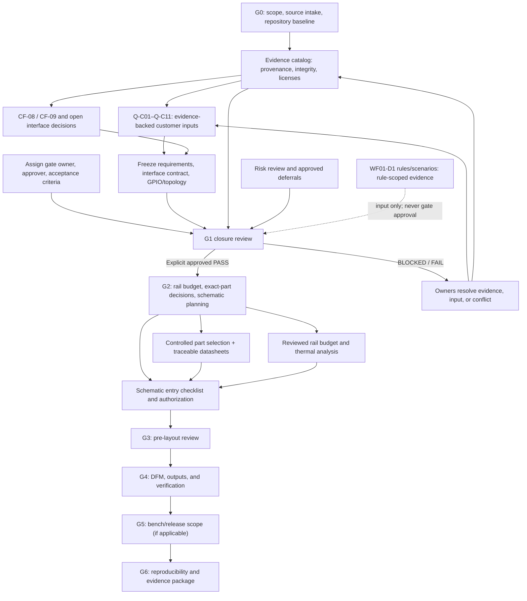

# Workflow dependency graph

The graph expresses prerequisites and handoffs, not completion. A blocked node prevents dependent activities from being treated as approved.

## Change-impact rules

- Changes to input/transient profiles reopen the protection decision and dependent rail/thermal calculations.
- Changes to Q-C07, GPIO assignments, module variant, USB/debug policy, or Q-C11 reopen the relevant GPIO/interface decisions.
- Changes to load/current, temperature, or exact parts invalidate the dependent rail/thermal calculations and reviews.
- Changes to manufacturing/profile assumptions reopen affected DFM, protection, and test criteria.
- Every reopened item retains the old evidence snapshot for audit and receives a new revision; stale approvals are not silently reused.
